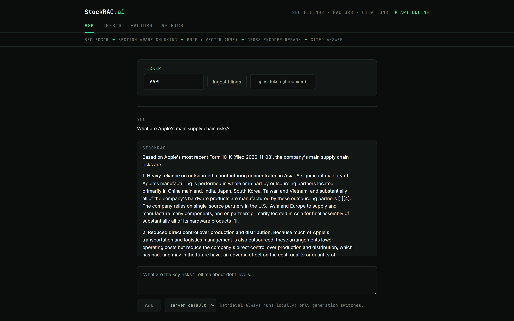
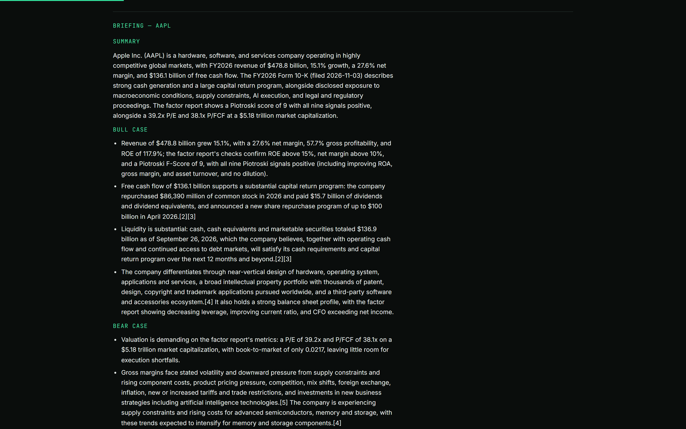
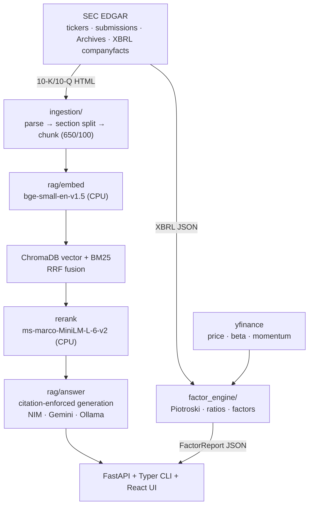
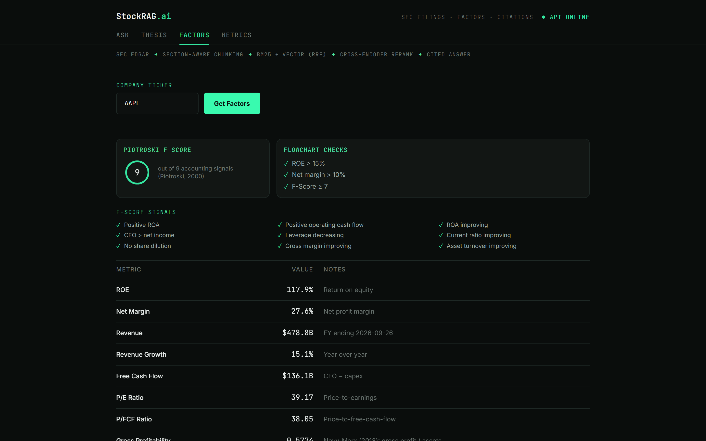

# StockRAG — Factor Engine + Ask-My-Docs RAG for SEC Filings

[](https://github.com/rajyyug1132/stockrag/actions/workflows/eval.yml)

[](LICENSE)



Ask a chatbot for Apple's Piotroski F-Score and you get a confident number
with no provenance. Ask it what the EU said about Irish state aid and you get
a summary of what it remembers reading in 2023.

Apple's last 10-K is 100+ pages of prose, and the numbers behind it live in a
separate XBRL exhibit nobody reads by hand. StockRAG treats those as two
different problems and refuses to blur them:

- **Numbers are computed, never generated.** The factor engine pulls SEC EDGAR
  XBRL (`companyfacts`) and calculates Piotroski F-Score (2000), Novy-Marx
  gross profitability (2013), Fama-French/Carhart characteristics, ROE, net
  margin, P/E, P/FCF and beta. No LLM touches an arithmetic path. Fields a
  source can't supply come back flagged in `missing` rather than guessed.
- **Prose answers must cite or die.** 10-K/10-Q text is chunked along Item
  boundaries, retrieved by hybrid BM25 + vector search fused with RRF, then
  rescored by a cross-encoder. If the generated answer contains no `[n]`
  marker pointing at a retrieved chunk, `src/stockrag/rag/answer.py` throws it
  away and returns a refusal. Citations pointing past the retrieved sources are
  dropped before that check. Sounding right is not a passing grade.

The interesting engineering is in the second bullet. A RAG demo that answers
every question is easy. One that knows when the filing simply doesn't say is
what needed the eval harness. CI runs a deterministic check of committed
answers on every merge; [Evaluation & CI gating](#evaluation--ci-gating) says
what that does and does not cover.

## What an answer looks like

```
$ uv run stockrag ask "What did the European Commission decide about Ireland
                       granting state aid to Apple?" AAPL

The European Commission decided on August 30, 2016, that Ireland granted state
aid to Apple by providing tax opinions in 1991 and 2007 concerning the tax
allocation of profits of the Irish branches of two subsidiaries [1]. The
Commission ordered Ireland to recover additional taxes for June 2003 through
December 2014 [1]. The General Court annulled that decision on July 15, 2020
[1]. The ECJ set aside the General Court's judgment on September 10, 2024 and
confirmed the 2016 decision [1], and Apple recorded a one-time income tax
charge of $10.2 billion in Q4 2024 [1].

Sources:
  [1] 10-K filed 2025-10-31 - other (0000320193-25-000079)
  [2] 10-K filed 2025-10-31 - item_1a_risk_factors (0000320193-25-000079)
  [3] 10-K filed 2025-10-31 - item_1a_risk_factors (0000320193-25-000079)
  [4] 10-K filed 2025-10-31 - item_3_legal_proceedings (0000320193-25-000079)
```

Every date and dollar figure above came out of the retrieved chunk. Ask
something the filing doesn't cover and you get the refusal instead, which the
eval suite scores as a metric in its own right.

The **Thesis** view goes a step further: it runs three fixed questions through
the same pipeline, joins the results to the XBRL factor report, and reports
how much of each section was actually grounded.

```
BRIEFING — AAPL

Bull case
- Capital allocation: returned $104.7B to shareholders in 2025 via $89.3B in
  buybacks and $15.4B in dividends, with a new $100B repurchase program [1]
- Piotroski 8/9: improving ROA, gross margin and asset turnover

Bear case
- High valuation: P/FCF 49.8, P/E 43.9
- Intense competition: aggressive pricing and rapid innovation from rivals in
  stagnant markets, pressuring gross margins [1][2]

UNDERLYING EVIDENCE
  risks               69% grounded
  competition        100% grounded
  capital allocation  71% grounded
```

Those percentages are the point. The briefing tells you which of its own
sections are well supported by the filing and which are thin, instead of
presenting every section with equal confidence.



## Architecture



In the default local configuration, embeddings, BM25 and the reranker all run
on CPU, so retrieval costs nothing and works offline. Only generation calls
out, to NVIDIA NIM (default), Gemini or a local Ollama model, selected per
request from the server's `LLM_PROVIDERS` allowlist. A hosted configuration
swaps the store and models; see [Hosted configuration](#hosted-configuration).

### Tech stack

| Layer | Default (local) | Hosted |
| --- | --- | --- |
| Orchestration | LangChain components, plain Python pipeline | same |
| Embeddings | `bge-small-en-v1.5` on CPU | NVIDIA NIM `nemotron-3.5-embed-1b` (1024-d) |
| Vector store | ChromaDB + BM25, fused with RRF | Supabase Postgres (pgvector + full-text) |
| Reranker | `ms-marco-MiniLM-L-6-v2` cross-encoder | NIM reranker, local fallback |
| LLM | NVIDIA NIM (`minimax-m3.1-flash`); Gemini or Ollama selectable | same |
| Financial data | SEC EDGAR XBRL `companyfacts`, yfinance | same |
| Serving | FastAPI, Typer CLI, React + Vite, Streamlit | HF Space / Vercel / Streamlit Cloud |
| Evaluation | Ragas + deterministic gates, GitHub Actions | same |
| Tracing | Langfuse (optional) | same |

## Setup

Requires [uv](https://docs.astral.sh/uv/) (pins Python 3.12; system 3.14 has
no torch/chromadb wheels yet).

```powershell
uv sync
copy .env.example .env   # fill NVIDIA_API_KEY (or GEMINI_API_KEY)
```

To try the pipeline without touching EDGAR, ingest the sample 10-K excerpt that
CI uses (`tests/fixtures/aapl_10k_excerpt.html`) and ask about it:

```powershell
uv run stockrag ingest-file tests/fixtures/aapl_10k_excerpt.html AAPL
uv run stockrag ask "What are the main risk factors?" AAPL
```

Optional local LLM: install [Ollama](https://ollama.com) and
`ollama pull qwen3:4b`, then use `--llm ollama`.

## Usage

```powershell
# Quantitative: factor report (EDGAR XBRL + yfinance, no LLM involved)
uv run stockrag factors AAPL

# Qualitative: ingest filings, then ask with citations
uv run stockrag ingest AAPL --forms 10-K --years 2
uv run stockrag ask "What are Apple's main risk factors?" AAPL
uv run stockrag ask "..." AAPL --llm ollama          # fully local generation

# Debug retrieval (hybrid+rerank vs pure vector, side by side)
uv run stockrag retrieve "EU state aid decision escrow" AAPL

# SRE metrics over recorded requests
uv run stockrag stats

# API server
uv run uvicorn stockrag.api.main:app --app-dir src
```

CLI commands: `stockrag ingest | ingest-file | ask | factors | retrieve | stats | health`.
API routes: `POST /ask`, `POST /ask/stream` (SSE), `GET /thesis/{ticker}`,
`GET /factors/{ticker}`, `POST /ingest/{ticker}` (`forms` and `years` query
parameters), `POST /ingest-pdf`, `GET /metrics`, `GET /health`, and a custom
`GET /docs`.

`ingest-file` and `POST /ingest-pdf` ingest a local document such as an Indian
annual-report PDF (form `annual-report`). Uploads over `MAX_UPLOAD_MB`
(default 20) get a 413.

## Web UI

React + Vite frontend over the same API. Four views: **Ask** (cited Q&A over
filings), **Thesis** (evidence briefing), **Factors** (XBRL factor report with
F-Score signals), **Metrics** (per-request latency, cost, citation coverage).

### Run locally

Two terminals, both started from the repo root (where `.env` lives):

```powershell
# terminal 1 — API on :8000
uv run uvicorn stockrag.api.main:app --app-dir src --port 8000 --env-file .env
# terminal 2 — UI on :5173
cd frontend; npm install; npm run dev
```

Open http://localhost:5173. The dot in the header polls `/health` every 15s:
**API online** (mint) means the UI can reach uvicorn, and **API offline** (red)
means it can't. In that case the header shows the command for terminal 1.
Vite proxies `/api` to `localhost:8000` in dev. Set `VITE_API_URL` (see
`frontend/.env.example`) only to point the UI at a non-proxied or deployed API.

Backend errors reach the UI as text. A 403, 404, 422 (unsupported `llm`) or 429
(rate limit) shows FastAPI's `detail` message, and a failure mid-stream on Ask
arrives as an `{"error": "Answer generation failed."}` SSE event instead of a
silently closed stream. An empty index is not an error: Ask returns the normal
no-context refusal.

There is a second, deliberately minimal Streamlit client in `streamlit_ui/`.
It speaks HTTP only, so it deploys to Streamlit Cloud without dragging torch
and chromadb along:

```powershell
uv run --with streamlit --with requests streamlit run streamlit_ui/streamlit_app.py
```

## Deploy

Three pieces, three free hosts:

| Piece | Host | Notes |
| --- | --- | --- |
| FastAPI backend | Hugging Face Spaces | The front matter selects the free Gradio SDK, which only runs `app.py`; `app.py` starts uvicorn, so it is the entrypoint. The `Dockerfile` builds the same app for the Docker SDK or any container host. Set `NVIDIA_API_KEY` as a Space secret and `CORS_ORIGINS` to the frontend origin (the default allows only `localhost:5173`). Retrieval models (~150MB) download on first boot. |
| React frontend | Vercel | Keep the Vercel root directory at the repo root: `vercel.json` there builds `frontend` (`npm ci --prefix frontend`, output `frontend/dist`). Set `VITE_API_URL` to the Space URL. |
| Streamlit client | Streamlit Cloud | Entrypoint `streamlit_ui/streamlit_app.py`. Set `STOCKRAG_API_URL` in app secrets. |

The Space starts with an empty vector store because free-tier storage is
ephemeral. Ingest a ticker once after boot (`POST /ingest/AAPL`, or the Ingest
button in the React UI), or set `AUTO_INGEST_TICKERS` to ingest at startup. It
stays indexed until the Space sleeps. Asking about a ticker before it is
ingested caches an empty keyword index for it, and newly ingested filings do
not refresh that index, so hybrid retrieval falls back to vector-only until the
server restarts.

`INGEST_TOKEN` (sent as an `X-Ingest-Token` header) guards `POST /ingest/{ticker}`,
`POST /ingest-pdf` and `GET /metrics`, so strangers can't spend your EDGAR
quota. It is optional with the Chroma store, but with `VECTOR_STORE=supabase`
ingest returns 503 until it is set. Known gaps once a token is set: the
Streamlit client's Ingest button sends no token and gets a 403, and the React
Metrics view shows no data.

Other server settings: `RATE_LIMIT_PER_MINUTE` (default 20 per IP on `/ask`,
`/ask/stream`, `/thesis` and `/factors`; in memory, per instance; 429 with
`Retry-After`) and `CLIENT_IP_HEADER` (behind a proxy such as a Space, all
clients share one rate-limit bucket until it is set).



Every number there came from XBRL or yfinance. The one failing F-Score signal
is operating cash flow below net income, and the report says so rather than
rounding 8/9 up to a clean story.

### Hosted configuration

The default setup keeps everything local (Chroma, bge, cross-encoder). The repo
also contains a hosted configuration:

- **Vector store:** `VECTOR_STORE=supabase` keeps chunks in Supabase Postgres
  (pgvector `vector(1024)` plus full-text search, queried through a
  `hybrid_search` RPC). The schema and the `request_metrics`, `thesis_cache` and
  `ticker_accessions` tables are in `supabase/migrations/`. Set `SUPABASE_URL`
  and `SUPABASE_SERVICE_KEY`.
- **Models:** it requires hosted embeddings (`EMBEDDING_PROVIDER=nvidia`,
  `NVIDIA_EMBED_MODEL`, `NVIDIA_EMBED_DIM=1024`). `RERANKER_PROVIDER` can use the
  NIM reranker, falling back to the local cross-encoder. An index only works
  with the embedder that built it.
- **API:** `api/index.py`, with its own slim `api/pyproject.toml`, is a Vercel
  serverless entrypoint for the API (`DATA_DIR=/tmp/stockrag`).
- **Scheduled ingest:** `.github/workflows/ingest.yml` ingests AAPL, MSFT and
  NVDA into Supabase every Monday at 06:17 UTC and can be run by hand with a
  ticker input. It needs the `SUPABASE_URL`, `SUPABASE_SERVICE_KEY` and
  `NVIDIA_API_KEY` repo secrets, and the weekly run keeps the free Supabase
  project from pausing.

## Observability

- **Tracing (Langfuse)** — set `LANGFUSE_PUBLIC_KEY` / `LANGFUSE_SECRET_KEY`
  in `.env` (they are not in `.env.example`; add `LANGFUSE_HOST` for a
  non-default host) and `/ask` traces retriever, reranker, prompt, and LLM
  spans to [Langfuse Cloud](https://cloud.langfuse.com). `/factors` is not
  traced and the thesis synthesis call has no tracing callbacks yet. Without
  keys, tracing is a silent no-op.
- **Metrics** — every `ask()` records stage latencies (`retrieval_ms`, which
  includes reranking, and `llm_ms`), citation coverage and refusal/error flags
  to `requests.jsonl` under `DATA_DIR/metrics/`, or to the `request_metrics`
  table with `VECTOR_STORE=supabase` (reads capped at 5000 rows). Token usage
  and cost are recorded for `ask()` only, not `ask_stream()` (which the React
  Ask view uses), and `MODEL_PRICES` in `src/stockrag/rag/metrics.py` prices
  only the Gemini 2.5 flash models, so cost shows 0 for the default NIM and Gemini models.
  `stockrag stats` reports P50/P95 latency, refusal/error rates, and cost per
  request.
- **Versioning** — prompts live in `src/stockrag/prompts/v*.yaml` (`v3` is the
  active QA prompt) plus `thesis_v1.yaml` for the thesis, and every response
  echoes its `prompt_version`, so eval results trace back to exact prompt
  configs. Thesis results are cached per ticker, keyed by the ingested
  accessions and the prompt version.

## Evaluation & CI gating

`eval/run_eval.py` runs the full pipeline over a golden QA dataset and
scores it with [Ragas](https://docs.ragas.io) (faithfulness, answer
relevancy, context precision/recall — judge follows the configured LLM
provider, local embeddings), plus
two locally computed gates: **citation coverage** (groundedness proxy) and
**refusal accuracy** on deliberately unanswerable questions.

```powershell
# live generation + Ragas judge: needs the provider's API key (NVIDIA_API_KEY by
# default) and AAPL ingested first, otherwise it exits with code 2
uv run python eval/run_eval.py --subset smoke            # 8 questions
uv run python eval/run_eval.py --subset golden           # full set
uv run python eval/run_eval.py --subset smoke --limit 3  # quota-constrained

# what CI runs: score the committed fixture offline, no judge, no keys
uv run python eval/run_eval.py --subset smoke --frozen eval/fixtures/smoke_answers.json --no-judge
# regenerate the fixture after pipeline changes that alter answers (repo root)
uv run python eval/run_eval.py --subset smoke --freeze eval/fixtures/smoke_answers.json
```

`--llm` and `--sleep` are also available; see `--help`.

The build fails when a gated metric drops below its threshold: citation
coverage ≥ 0.60 or refusal accuracy ≥ 0.50. The Ragas metrics (faithfulness,
answer relevancy, context precision and recall) are advisory and never fail
the build.

Latest smoke run (8 questions, frozen answer fixture, deterministic gates):

| Metric | Score | Threshold |
| --- | --- | --- |
| Citation coverage | 0.83 | ≥ 0.60 |
| Refusal accuracy | 1.00 | ≥ 0.50 |

GitHub Actions (`.github/workflows/eval.yml`) runs unit tests on every PR,
then ingests a committed filing fixture (never hitting EDGAR from CI) and
gates the merge on the smoke eval. The gate is fully offline — it scores a
committed answer fixture with deterministic metrics only, no API keys. Live
generation on free shared endpoints proved non-reproducible (faithfulness
swinging 0.86 → 0.375 on identical inputs), so judge metrics stay advisory
and are run locally. The trade-off: the gate checks the committed answers, not
the live pipeline, so a change to retrieval, prompts or the model cannot fail
it until the fixture is regenerated. The CI ingest step is a separate
integration check on the fixture filing.

## Design decisions

- **XBRL over LLM extraction** for financial numbers: deterministic, free,
  multi-year history; the only real work is the priority-ordered tag
  fallback map in `src/stockrag/edgar/companyfacts.py`.
- **Section-aware chunking** (650 tokens, 100 overlap, never crossing an
  Item boundary) keeps citations attributable to Item 1A / Item 7 / etc.
- **Local-first retrieval** (bge-small + ms-marco reranker on CPU, in the
  default configuration): zero cost and offline; only generation calls out.
- **EDGAR etiquette**: descriptive User-Agent with contact email, ≤8 req/s
  throttle, aggressive disk caching, and no EDGAR traffic from CI. Cached
  submissions, companyfacts and ticker files never expire, so new filings and
  fiscal years appear only after you clear `data/`.

## Tests

```powershell
uv run pytest -q          # chunking, parsing, XBRL, Piotroski, ratios, API security, streaming, Supabase store, migrations
uv run ruff check src tests eval streamlit_ui
```

The migration tests run against a throwaway Postgres with pgvector (`pgserver`,
in the default dev group).
